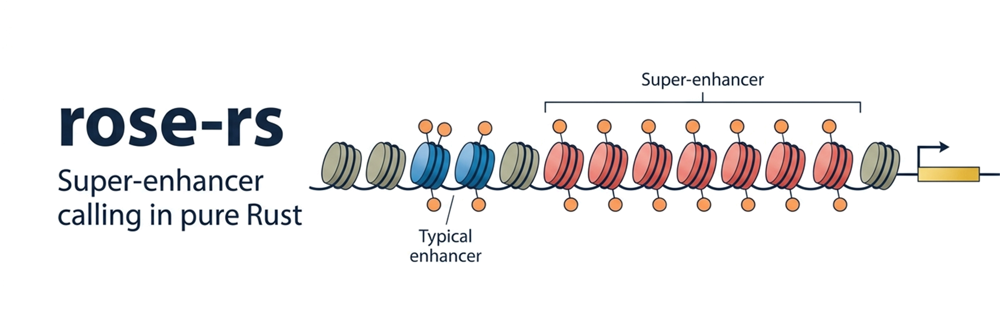

<p align="center">
  
</p>

# `rose-rs` — Fast, Self-Contained Super-Enhancer Calling in Pure Rust

`rose-rs` (`rose`) is a clean-room, memory-safe (`#![forbid(unsafe_code)]`), zero-C-dependency Rust reimplementation and extension of the Young Lab **ROSE** (*Rank Ordering of Super-Enhancers*; Whyte et al., *Cell* 2013; Lovén et al., *Cell* 2013) pipeline, incorporating copy-number and bigWig enhancements inspired by **LILY** (Boeva et al., *Nature Genetics* 2017) plus native **CUT&RUN**, **multi-sample cohort**, and **bootstrap/downsampling stability** modes.

## How It Works


`rose run` chains the four stages in one process. Each stage is also available on its own as `rose stitch`, `rose signal`, `rose call` and `rose genes`.

---

## Key Improvements Over Legacy ROSE & LILY

| Capability | Legacy ROSE (Python 2 + R + `samtools`) | `rose-rs` (`rose` single static binary) |
|---|---|---|
| **Runtime dependencies** | Python 2.7, R, `samtools` on `$PATH`, working-directory assumptions | **None** — 100% pure Rust (`noodles` + `zlib-rs` + `plotters` + embedded `DejaVuSans.ttf`) |
| **BAM / CRAM quantification** | Spawns `samtools view` per region + Python `dict` per base + 5-minute `sleep(300)` polling | In-process parallel `rayon` decoding + $O(1)$ overlap (`floor = 0`) or reusable per-thread difference array (`floor > 0`) |
| **Paired-end & CUT&RUN** | Treats mates as independent single-end reads extended by 200 bp; counts PCR duplicates | Proper-pair `[POS, POS + TLEN)` fragments counted once from leftmost mate, `MAPQ`/dedup/fragment-length filters, `--assay cutrun` preset |
| **BigWig & Copy Number** | Not supported in ROSE; LILY loads entire bigWig twice with unweighted bin sums | Indexed pure-Rust UCSC BigWig v4 width-weighted integration + single-pass `--cn-correct` (100 kb bins) and `--cn-segments` (`.seg`/BED) |
| **Tangent cutoff** | R `stats::optimize` Brent search on a discontinuous step function | Exact $O(N)$ chord-tangent scan with rightmost tie-breaking (`--cutoff rose-compat` retains exact R Brent solver) |
| **Gene mapping & BED tracks** | Drops IDs starting with `'R'`; `append=TRUE` duplicates Gateway BED on rerun; invalid `> 1000` BED scores | Typed schema writers, atomic temp-file-and-rename (`AtomicWriter`), valid `0..=1000` UCSC BED scores |
| **Stitching & scale sensitivity** | Hardcoded 12.5 kb empirical mouse ESC window; re-evaluating requires full BAM re-runs | **Zero-I/O piecewise peak + gap engine** (`0..=25 kb` sensitivity report `*_Stitch_sensitivity.tsv` on every run) + signal-blind **`--stitch auto`** with `[2 kb, 25 kb]` clamp & `12.5 kb` fallback |
| **Legacy parity** | Reference implementation | `--compat rose` reproduces legacy ROSE 0.1 stitching, read/region counting, 4-decimal rounding, and R Brent cutoff (checked against an independent re-implementation in `tests/golden/`); MMR comes from the `.bai` index rather than `samtools flagstat` |

---

## Workspace Layout

```text
ROSE-RS/
├── Cargo.toml                  # Workspace config & strict lints (#![forbid(unsafe_code)])
├── SKILL.md                    # Portable AI Agent Skill specification (Claude Code, Codex, Copilot, Antigravity)
├── tests/golden/               # Synthetic fixture + independent ROSE-rules reference used by the golden tests
└── crates/
    ├── rose-core/              # Pure I/O-free algorithms: intervals, TSS, stitch, stitch_sweep, signal, cutoff, genes, stability, CN, multi
    ├── rose-io/                # BAM/CRAM (noodles), pure-Rust BigWig v4, BED/narrowPeak/broadPeak/GFF/GTF/refGene, atomic TSV/BED writers
    └── rose-cli/               # `rose-rs` package: `rose` CLI subcommands, rayon orchestration, static-safe SVG & PNG hockey-stick plots
```

---

## Quick Start

### Install

Download a prebuilt `rose` binary for Linux, macOS or Windows from the
[latest release](https://github.com/ziwenzhu/ROSE-RS/releases/latest). Each
archive has a `.sha256` checksum next to it. Or install from source with Rust
1.91 or newer:

```bash
cargo install --locked --git https://github.com/ziwenzhu/ROSE-RS --tag v1.0.0 rose-rs
rose --version
```

### Build from Source

```bash
cargo build --release
# Binary produced at target/release/rose (or target\release\rose.exe on Windows)
```

Changes between versions are listed in [CHANGELOG.md](CHANGELOG.md).

### Standard ChIP-seq Super-Enhancer Run

```bash
rose run \
  -i H3K27ac_peaks.narrowPeak \
  -r H3K27ac.bam \
  -c Input.bam \
  -a hg38_refseq.ucsc \
  -t 2500 \
  -o results/H3K27ac
```

### Paired-End H3K27ac / MED1 CUT&RUN Run

```bash
rose run \
  --assay cutrun \
  --blacklist hg38-blacklist.v2.bed \
  -i H3K27ac_cutrun.broadPeak \
  -r H3K27ac_cutrun.bam \
  -c IgG_cutrun.bam \
  --compare-control \
  -a hg38_refseq.ucsc \
  -t 2500 \
  -o results/cutrun_H3K27ac
```

### Amplicon-Aware Copy-Number Correction & Stability Bootstrap

```bash
rose run \
  -i peaks.bed \
  -r tumor_H3K27ac.bam \
  -c tumor_Input.bam \
  -a hg38_refseq.ucsc \
  -t 2500 \
  --cn-correct \
  --stability 1000 \
  --seed 42 \
  -o results/tumor_cn_corrected
```

### Multi-Sample & Replicate Cohort Mode

Create a tab-separated `samples.tsv`:

```tsv
sample	group	peaks	bam	control
DMSO_rep1	DMSO	dmso1.narrowPeak	dmso1.bam	input1.bam
DMSO_rep2	DMSO	dmso2.narrowPeak	dmso2.bam	input2.bam
JQ1_rep1	JQ1	jq1_1.narrowPeak	jq1_1.bam	input1.bam
JQ1_rep2	JQ1	jq1_2.narrowPeak	jq1_2.bam	input2.bam
```

Run `rose multi`:

```bash
rose multi \
  --samples samples.tsv \
  --min-peak-samples 2 \
  -a hg38_refseq.ucsc \
  -t 2500 \
  -o results/cohort_jq1_vs_dmso
```

### Exact Legacy Young Lab ROSE Compatibility Mode

```bash
rose run \
  --compat rose \
  -i peaks.gff \
  -r treat.bam \
  -c control.bam \
  -a hg38_refseq.ucsc \
  -t 2500 \
  -o results/legacy_rose_compat
```

---

## Subcommands

| Subcommand | Purpose |
|---|---|
| `rose run` | Execute the complete `stitch -> signal -> call -> genes` pipeline in memory with SVG/PNG plots and `run.json` provenance |
| `rose stitch` | Filter blacklisted/promoter-contained constituents, stitch within `--stitch` (12.5 kb), and disaggregate `> --max-tss-genes` spans |
| `rose signal` | Quantify BAM, CRAM (`--reference genome.fa` required), or BigWig signal across regions into `*_ENHANCER_REGION_MAP.txt` |
| `rose call` | Compute the super-enhancer tangent cutoff, ranked enhancer tables, valid `0..=1000` BED tracks, and hockey-stick plots |
| `rose genes` | Map ranked enhancers to overlapping, proximal (`±50 kb`), and closest genes (`ENHANCER_TO_GENE` and `GENE_TO_ENHANCER`) |
| `rose multi` | Pool consensus peaks across samples, normalize via DESeq2 median-of-ratios (`>= 80%` positive subset), call replicate consensus, and label `gained`/`lost`/`shared` |
| `rose fetch-annotation` | Install pre-downloaded UCSC `refGene` annotations (`--from-dir`) into a local `annotations/` cache for `--genome` lookup |

---

## Performance & Memory Footprint

Measured on 8 threads (`target/release/rose`, pure-Rust `noodles` + `zlib-rs`, zero `unsafe` code, full `58,350`-transcript `hg38` RefSeq annotation, `0..=25 kb` 10-point stitch sensitivity sweep, BED tracks, and SVG + PNG plot rendering):

| Sample Scenario | Reads & Peaks | Wall Time (`8` threads) | Peak RSS |
|---|---|---|---|
| **CUT&RUN (`--assay cutrun -s auto`)** | `8M` reads, `15,000` peaks | **`2.20 s`** | **`68.1 MiB`** |
| **ChIP-seq (no control)** | `30M` ChIP reads, `20,020` peaks | **`5.71 s`** | **`74.2 MiB`** |
| **ChIP-seq + Input (`-s auto`)** | `30M` ChIP + `30M` Input (`60M` reads), `20,020` peaks | **`9.41 s`** | **`73.9 MiB`** |
| **ChIP-seq + Input + `--cn-correct` + `--stability 200`** | `30M` ChIP + `30M` Input (`60M` reads), `20,020` peaks | **`9.55 s`** | **`79.9 MiB`** |
| **`rose multi` 4-sample cohort (`-s auto`)** | `4 × (30M ChIP + 30M Input)` (`240M` reads) | **`35.18 s` (`8.80 s / sample`)** | **`112.9 MiB`** |

---

## AI Agent Skill (`SKILL.md`)

`rose-rs` ships with an Agent Skill specification at `SKILL.md`. To install it globally across coding agents:

```bash
# Copy into your global agent skills directory (or run `npx skills add <repo>`)
mkdir -p ~/.agents/skills/rose-rs && cp SKILL.md ~/.agents/skills/rose-rs/
```

---

## Citation

If you use `rose-rs`, please cite the papers that introduced ROSE and super-enhancers:

- Whyte WA, et al. Master transcription factors and mediator establish super-enhancers at key cell identity genes. *Cell* 153, 307–319 (2013).
- Lovén J, et al. Selective inhibition of tumor oncogenes by disruption of super-enhancers. *Cell* 153, 320–334 (2013).

and, for the copy-number and bigWig features, Boeva V, et al. *Nature Genetics* 49, 1408–1413 (2017) (LILY).

## License

MIT License (see `LICENSE`). This is a clean-room Rust implementation; see `PORTING.md` for the algorithmic correspondence with ROSE. The embedded DejaVu Sans font used for plots is distributed under its own licence (`crates/rose-cli/assets/DejaVuSans-LICENSE.txt`).
